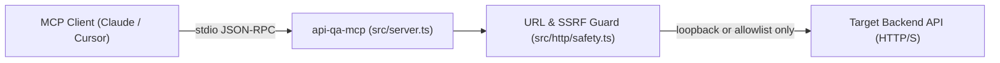

# api-qa-mcp

Backend API QA, OpenAPI contract validation, negative boundary testing, and concurrency/idempotency probing over the [Model Context Protocol (MCP)](https://modelcontextprotocol.io/).

## Architecture



## Safety Guardrails

1. **Loopback-First SSRF Protection (`src/http/safety.ts`)**: By default, only `localhost`, `127.0.0.1`, and `::1` targets are allowed. External staging hosts require explicit opt-in via `API_QA_ALLOWED_HOSTS`. Cloud metadata IPs (`169.254.169.254`, `metadata.google.internal`) are always blocked.
2. **Timeouts & Payload Caps (`src/http/client.ts`)**: Every request enforces `AbortSignal.timeout` (default `5000ms`, max `30000ms`) and caps response body reads at `1 MB`.
3. **Header Redaction**: Sensitive headers (`Authorization`, `Cookie`, `X-Api-Key`, `X-Auth-Token`) are masked as `[REDACTED]` in diagnostic responses.

## Available Tools

| Tool | Purpose |
| :--- | :--- |
| `discover_endpoints` | Parses OpenAPI 3.x / Swagger 2.0 specs from a URL, `base_url` probe, or inline JSON. |
| `run_negative_tests` | Sends empty JSON, malformed JSON, wrong field types, negative numbers, oversized strings, and missing-auth probes to catch `5xx` crashes and leaked stack traces. |
| `check_contract_drift` | Executes a live request and validates the JSON response against the documented OpenAPI schema. |
| `probe_idempotency_race` | Sends N concurrent identical requests with the same `Idempotency-Key` to detect duplicate creations or concurrency errors. |
| `audit_http_security` | Checks `X-Content-Type-Options`, clickjacking headers, HSTS, `X-Powered-By` leakage, CORS wildcard+credentials, and optional unauthenticated access. |

## Quick Start

```bash
npm install
npm run build
npm test
```

## MCP Client Configuration

```json
{
  "mcpServers": {
    "api-qa": {
      "command": "node",
      "args": ["/absolute/path/to/api-qa-mcp/dist/index.js"],
      "env": {
        "API_QA_ALLOWED_HOSTS": "localhost,127.0.0.1"
      }
    }
  }
}
```

## Environment Variables

- `API_QA_ALLOWED_HOSTS`: Comma-separated list of non-loopback hostnames permitted for testing.

## License

MIT
